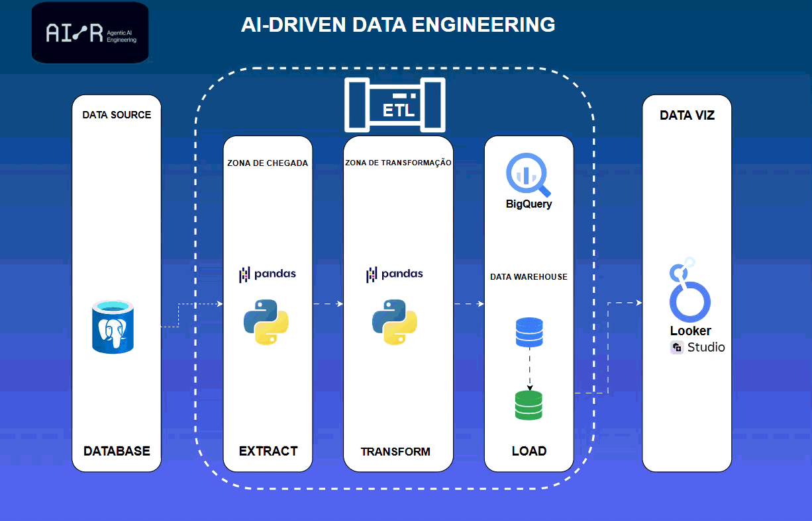

# Análise de Vendas Automotivas

**Pipeline ETL | Data Warehouse | Business Intelligence**

Projeto de Engenharia de Dados desenvolvido para analisar o comportamento dos clientes durante a jornada de compra automotiva, identificando oportunidades de melhoria no funil de vendas e gerando informações para apoiar decisões de negócio.

O projeto teve início como aplicação prática dos conhecimentos adquiridos no curso **SQL para Análise de Dados** e evoluiu durante o programa **AI/R Fellowship | AI-Driven Data Engineering**.

---

## 🎯 Objetivo do projeto

Construir um fluxo de dados capaz de extrair informações de um banco de dados PostgreSQL, realizar transformações e tratamentos com Python e Pandas, disponibilizar os dados em um Data Warehouse no Google BigQuery e gerar análises por meio do Looker Studio.

## 🏗️ Arquitetura do projeto

O fluxo foi estruturado seguindo o processo ETL (Extract, Transform, Load).


**Fluxo de dados:**

`PostgreSQL → Python/Pandas → BigQuery → Looker Studio`

### Etapas da arquitetura

| Etapa | Descrição | Tecnologias |
|---|---|---|
| Extract | Extração dos dados do banco de origem | PostgreSQL, Python, SQLAlchemy |
| Transform | Limpeza, padronização e tratamento dos dados | Python, Pandas |
| Load | Carga dos dados no Data Warehouse | Google BigQuery |
| Analytics | Consultas analíticas e visualização dos indicadores | SQL, Looker Studio |

## 🛠️ Tecnologias utilizadas

- **Python:** desenvolvimento do pipeline ETL.
- **Pandas:** manipulação e transformação dos dados.
- **PostgreSQL:** banco de dados de origem.
- **SQLAlchemy:** conexão e integração com o banco de dados.
- **Google Cloud Platform (GCP):** infraestrutura de dados.
- **Google BigQuery:** armazenamento e processamento analítico.
- **SQL:** consultas e criação de Views analíticas.
- **Looker Studio:** construção do dashboard interativo.
- **Git e GitHub:** versionamento e documentação do projeto.

## 🗄️ Data Warehouse

No BigQuery, os dados foram organizados em datasets com responsabilidades distintas:

**1. Automotive Staging**

Camada de chegada dos dados tratados, organizados em tabelas para disponibilização e validação.

**2. Automotive Marts**

Camada destinada à organização dos dados para análises de negócio.

**3. Automotive Views**

Camada de consultas analíticas, com Views desenvolvidas em SQL para alimentar os indicadores do dashboard.

## 📊 Análises desenvolvidas

O dashboard apresenta indicadores relacionados ao comportamento dos clientes durante a jornada de compra.

Principais indicadores:

- Total de visitas.
- Total de carrinhos.
- Total de checkouts.
- Total de finalizações.
- Total de pagamentos.
- Conversão entre etapas do funil.
- Abandono por etapa.
- Taxa de conversão geral.
- Taxa de pagamento.

### Resultados apresentados

| Indicador | Resultado |
|---|---:|
| Total de visitas | 30.580 |
| Total de carrinhos | 20.020 |
| Total de checkouts | 4.198 |
| Total de finalizações | 3.807 |
| Total de pagamentos | 3.788 |
| Conversão geral | 12,39% |
| Taxa de pagamento | 99,50% |

*Indicadores referentes à execução analisada do projeto.*

## 📁 Estrutura do repositório

```text
projeto-vendas-automotivas/
│
├── Dataset/
│   ├── brutos/
│   └── tratados/
│
├── Docs/
│   └── img/
│
├── ETL/
│   ├── extraction.ipynb
│   ├── transform.ipynb
│   └── load.ipynb
│
├── sql/
│
├── .gitignore
├── .env.example
└── README.md
```

## ⚙️ Execução do projeto

### Pré-requisitos

- Python 3.x
- PostgreSQL
- Conta e projeto configurados no Google Cloud Platform.
- BigQuery API habilitada.
- Credenciais de acesso ao BigQuery.
- Bibliotecas Python utilizadas no pipeline.

### Instalação das dependências

```bash
pip install pandas sqlalchemy psycopg2-binary python-dotenv google-cloud-bigquery
```

### Configuração das variáveis de ambiente

Configure as credenciais de conexão no arquivo `.env`, seguindo o modelo disponibilizado em `.env.example`.

**Importante:** não compartilhe credenciais, senhas ou arquivos `.env` no repositório.

### Ordem de execução

1. `extraction.ipynb` — extração dos dados do PostgreSQL.
2. `transform.ipynb` — tratamento e transformação dos dados.
3. `load.ipynb` — carregamento dos dados no BigQuery.

Após a carga, as consultas SQL e as Views analíticas disponibilizam os dados para a construção do dashboard.

## 📈 Dashboard

O projeto utiliza o Looker Studio para apresentar os indicadores de desempenho e permitir a análise visual do funil de vendas automotivas.

## 🚀 Evolução do projeto

Esta publicação representa a primeira etapa do desenvolvimento.

O projeto continuará evoluindo, com novas implementações, análises e melhorias na arquitetura de dados.

Novas funcionalidades e aprimoramentos serão documentados neste repositório.

## 👨‍💻 Autor

**Wallace Almeida**

Estudante de Tecnologia em Internet das Coisas e profissional de Tecnologia da Informação, com foco em Engenharia de Dados, Cloud Computing e Analytics.

Projeto desenvolvido como parte da jornada de aprendizado em SQL para Análise de Dados e AI/R Fellowship | AI-Driven Data Engineering.

---

**Transformando dados em informações para decisões melhores.** 🚀

#DataEngineering #Python #SQL #PostgreSQL #BigQuery #GoogleCloud #Pandas #LookerStudio #DataAnalytics #ETL
